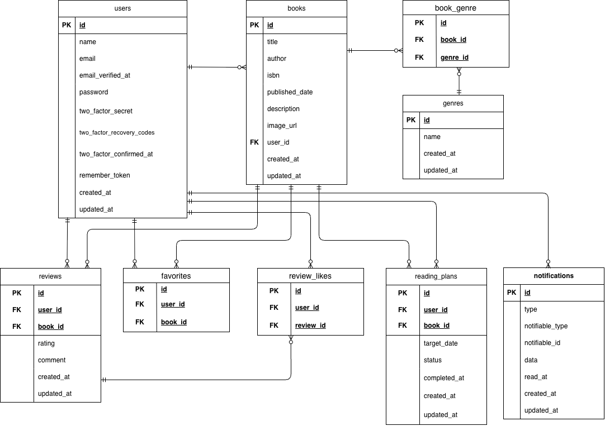

# BookShelf

## 環境構築

1. Dockerを起動する

2. リポジトリをクローンする

```bash
git clone https://github.com/3170sailing/bookshelf-app.git
cd bookshelf-app
```

3. Composerパッケージをインストールする

```bash
docker run --rm \
    -u "$(id -u):$(id -g)" \
    -v "$(pwd):/var/www/html" \
    -w /var/www/html \
    -e COMPOSER_CACHE_DIR=/tmp/composer_cache \
    laravelsail/php82-composer:latest \
    composer install
```

4. `.env` ファイルを作成する

```bash
cp .env.example .env
```

`.env` のデータベース設定を以下のように設定してください。

```env
DB_CONNECTION=mysql
DB_HOST=mysql
DB_PORT=3306
DB_DATABASE=laravel
DB_USERNAME=sail
DB_PASSWORD=password
```

5. Laravel Sailを起動する

```bash
./vendor/bin/sail up -d
```

phpMyAdminは以下のURLからアクセスできます。

```text
http://localhost:8080
```

6. アプリケーションキーを生成する

```bash
./vendor/bin/sail artisan key:generate
```

7. フロントエンドのパッケージをインストールする

```bash
./vendor/bin/sail npm install
```

8. フロントエンドをビルドする

```bash
./vendor/bin/sail npm run build
```

9. マイグレーションとシーディングを実行する

```bash
./vendor/bin/sail artisan migrate --seed
```

既存のデータベースをリセットして再構築する場合は、以下を実行してください。

```bash
./vendor/bin/sail artisan migrate:fresh --seed
```

## Google Books APIについて

書籍登録・編集画面では、Google Books APIを利用して13桁のISBNから書籍情報を取得できます。

Google Books APIのAPIキーを取得し、`.env` ファイルに以下のように設定してください。

```env
GOOGLE_BOOKS_API_KEY=取得したAPIキー
```

ISBN検索によって取得した書籍情報を、書籍登録・編集フォームへ反映できます。

## 主な機能

### 基本機能

- 会員登録
- ログイン・ログアウト
- 書籍一覧表示
- 書籍詳細表示
- 書籍登録
- 書籍編集
- 書籍削除
- ジャンル管理
- レビュー投稿・編集・削除
- お気に入り登録・解除
- レビューへのいいね・解除
- 書籍ランキング

### 応用機能

- キーワードによる書籍検索
- ジャンルによる絞り込み
- 書籍の並び替え
- Google Books APIを利用したISBN検索
- 読書レポート
- Laravel Sanctumを利用したREST API
- 読書計画の登録・編集・削除
- 読了管理
- 読書期日のリマインダー通知
- 通知一覧・既読管理

## APIについて

Laravel Sanctumを利用したREST APIを実装しています。

| Method | Endpoint | 内容 | 認証 |
| --- | --- | --- | --- |
| GET | `/api/v1/books` | 書籍一覧取得 | 不要 |
| GET | `/api/v1/books/{book}` | 書籍詳細取得 | 不要 |
| POST | `/api/v1/books` | 書籍登録 | 必要 |
| PUT | `/api/v1/books/{book}` | 書籍更新 | 必要 |
| DELETE | `/api/v1/books/{book}` | 書籍削除 | 必要 |

書籍一覧では以下のパラメータを利用できます。

| パラメータ | 内容 |
| --- | --- |
| keyword | タイトル・著者名による検索 |
| genre_id | ジャンルによる絞り込み |
| page | ページ番号 |
| per_page | 1ページあたりの件数 |

書籍の登録・更新・削除にはLaravel Sanctumによる認証が必要です。

## テーブル仕様

### usersテーブル

| カラム名 | 型 | primary key | unique key | not null | foreign key |
| --- | --- | --- | --- | --- | --- |
| id | bigint | ◯ |  | ◯ |  |
| name | varchar(255) |  |  | ◯ |  |
| email | varchar(255) |  | ◯ | ◯ |  |
| email_verified_at | timestamp |  |  |  |  |
| password | varchar(255) |  |  | ◯ |  |
| two_factor_secret | text |  |  |  |  |
| two_factor_recovery_codes | text |  |  |  |  |
| two_factor_confirmed_at | timestamp |  |  |  |  |
| remember_token | varchar(100) |  |  |  |  |
| created_at | timestamp |  |  |  |  |
| updated_at | timestamp |  |  |  |  |

### booksテーブル

| カラム名 | 型 | primary key | unique key | not null | foreign key |
| --- | --- | --- | --- | --- | --- |
| id | bigint | ◯ |  | ◯ |  |
| title | varchar(255) |  |  | ◯ |  |
| author | varchar(255) |  |  | ◯ |  |
| isbn | varchar(13) |  | ◯ |  |  |
| published_date | date |  |  |  |  |
| description | varchar(255) |  |  |  |  |
| image_url | varchar(255) |  |  |  |  |
| user_id | bigint |  |  | ◯ | users(id) |
| created_at | timestamp |  |  |  |  |
| updated_at | timestamp |  |  |  |  |

### genresテーブル

| カラム名 | 型 | primary key | unique key | not null | foreign key |
| --- | --- | --- | --- | --- | --- |
| id | bigint | ◯ |  | ◯ |  |
| name | varchar(255) |  | ◯ | ◯ |  |
| created_at | timestamp |  |  |  |  |
| updated_at | timestamp |  |  |  |  |

### book_genreテーブル

| カラム名 | 型 | primary key | unique key | not null | foreign key |
| --- | --- | --- | --- | --- | --- |
| id | bigint | ◯ |  | ◯ |  |
| book_id | bigint |  | ◯（genre_idとの組み合わせ） | ◯ | books(id) |
| genre_id | bigint |  | ◯（book_idとの組み合わせ） | ◯ | genres(id) |

### reviewsテーブル

| カラム名 | 型 | primary key | unique key | not null | foreign key |
| --- | --- | --- | --- | --- | --- |
| id | bigint | ◯ |  | ◯ |  |
| user_id | bigint |  |  | ◯ | users(id) |
| book_id | bigint |  |  | ◯ | books(id) |
| rating | tinyint unsigned |  |  | ◯ |  |
| comment | text |  |  | ◯ |  |
| created_at | timestamp |  |  |  |  |
| updated_at | timestamp |  |  |  |  |

### favoritesテーブル

| カラム名 | 型 | primary key | unique key | not null | foreign key |
| --- | --- | --- | --- | --- | --- |
| id | bigint | ◯ |  | ◯ |  |
| user_id | bigint |  | ◯（book_idとの組み合わせ） | ◯ | users(id) |
| book_id | bigint |  | ◯（user_idとの組み合わせ） | ◯ | books(id) |

### review_likesテーブル

| カラム名 | 型 | primary key | unique key | not null | foreign key |
| --- | --- | --- | --- | --- | --- |
| id | bigint | ◯ |  | ◯ |  |
| user_id | bigint |  | ◯（review_idとの組み合わせ） | ◯ | users(id) |
| review_id | bigint |  | ◯（user_idとの組み合わせ） | ◯ | reviews(id) |

### reading_plansテーブル

| カラム名 | 型 | primary key | unique key | not null | foreign key |
| --- | --- | --- | --- | --- | --- |
| id | bigint | ◯ |  | ◯ |  |
| user_id | bigint |  |  | ◯ | users(id) |
| book_id | bigint |  |  | ◯ | books(id) |
| target_date | date |  |  | ◯ |  |
| status | varchar(255) |  |  | ◯ |  |
| completed_at | timestamp |  |  |  |  |
| created_at | timestamp |  |  |  |  |
| updated_at | timestamp |  |  |  |  |

### notificationsテーブル

| カラム名 | 型 | primary key | unique key | not null | foreign key |
| --- | --- | --- | --- | --- | --- |
| id | char(36) | ◯ |  | ◯ |  |
| type | varchar(255) |  |  | ◯ |  |
| notifiable_type | varchar(255) |  |  | ◯ |  |
| notifiable_id | bigint |  |  | ◯ |  |
| data | text |  |  | ◯ |  |
| read_at | timestamp |  |  |  |  |
| created_at | timestamp |  |  |  |  |
| updated_at | timestamp |  |  |  |  |

## ER図



## テストアカウント

### テストユーザー1

name: 山田太郎  
email: yamada@example.com  
password: password

### テストユーザー2

name: 鈴木花子  
email: suzuki@example.com  
password: password

### テストユーザー3

name: 田中一郎  
email: tanaka@example.com  
password: password

### テストユーザー4

name: 佐藤美咲  
email: sato@example.com  
password: password

### テストユーザー5

name: 高橋健太  
email: takahashi@example.com  
password: password

## PHPUnitを利用したテストに関して

以下のコマンドでテストを実行できます。

```bash
./vendor/bin/sail artisan test
```

テストカバレッジを確認する場合は以下を実行します。

```bash
./vendor/bin/sail artisan test --coverage
```

## Laravel Pintについて

以下のコマンドでコードを整形できます。

```bash
./vendor/bin/pint
```

以下のコマンドでフォーマットに問題がないことを確認できます。

```bash
./vendor/bin/pint --test
```

## Schedulerについて

読書計画のリマインダー処理は毎日20:00に実行されます。

ローカル環境でSchedulerを実行する場合は以下のコマンドを実行してください。

```bash
./vendor/bin/sail artisan schedule:work
```

リマインダー処理を手動で実行する場合は以下のコマンドを実行してください。

```bash
./vendor/bin/sail artisan reading-plans:process-reminders
```